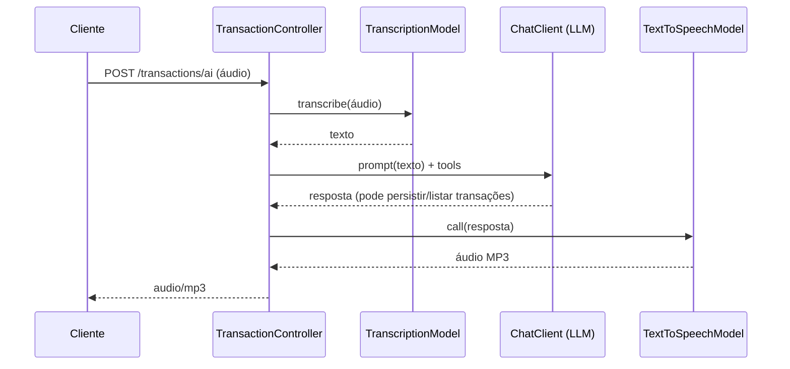

# Budget API

API REST para registro e consulta de transações financeiras, com suporte a **interação por voz** (transcrição de áudio e resposta em áudio) usando Inteligência Artificial.

O projeto foi construído com **Spring Boot 4** e **Spring AI**, seguindo uma arquitetura em camadas inspirada em **Clean Architecture** (domínio, aplicação e infraestrutura).

---

## 📋 O que o projeto faz

A Budget API permite:

- **Registrar transações financeiras** (descrição, valor e categoria) via requisição HTTP.
- **Listar transações por categoria**.
- **Interagir por voz**: enviar um áudio descrevendo um gasto (ex.: _"gastei 50 reais no mercado"_), que é:
  1. **Transcrito** para texto (Speech-to-Text);
  2. **Processado por um modelo de chat** que decide, via _tool calling_, se deve persistir ou listar transações;
  3. **Respondido em áudio** (Text-to-Speech) no formato MP3.

### Categorias disponíveis

| Categoria   | Descrição                     |
|-------------|-------------------------------|
| `GROCERIES` | Mercado e supermercado        |
| `PHARMA`    | Farmácia e medicamentos       |
| `AUTO`      | Automóvel e combustível       |
| `OTHER`     | Outros                        |

---

## 🏗️ Arquitetura

O código está organizado em três camadas principais:

```
com.wgabbriel.budgetapi
├── domain/            # Regras de negócio puras (Transaction, Category, TransactionID, TransactionRepository)
├── application/       # Casos de uso (PersistTransactionUseCase, ListTransactionByCategoryUseCase, MoneyNormalizer)
└── infraestructure/   # Adaptadores: HTTP (controllers, DTOs, OpenAPI) e persistência (JPA)
```

- **`domain`**: entidades e contratos de repositório, sem dependência de frameworks.
- **`application`**: casos de uso expostos também como _tools_ do Spring AI (`@Tool`), permitindo que o modelo de IA os invoque.
- **`infraestructure`**: controllers REST, DTOs de request/response, configuração do Swagger/OpenAPI e implementação JPA do repositório.

### Fluxo de voz (`POST /transactions/ai`)



---

## 🛠️ Tecnologias

- **Java 21**
- **Spring Boot 4.2.0-M2**
- **Spring AI 2.0.0-M4** (starter OpenAI)
- **Spring Data JPA** + **PostgreSQL 16**
- **springdoc-openapi** (Swagger UI)
- **Lombok**
- **Gradle**
- **Docker / Docker Compose**

> **Provedor de IA:** o projeto usa o **OpenRouter** como base URL (`https://openrouter.ai/api`), portanto a chave de API deve ser uma chave do OpenRouter (`sk-or-v1-...`) e os nomes dos modelos devem usar os _slugs_ do OpenRouter (ex.: `openai/gpt-6-luna`).

---

## 🚀 Como executar

### Pré-requisitos

- [Docker](https://www.docker.com/) e Docker Compose **ou**
- **JDK 21** + **Gradle** (o wrapper `./gradlew` já está incluído) e um PostgreSQL acessível.

### 1. Configurar variáveis de ambiente

Copie os arquivos de exemplo e preencha os valores:

```bash
cp application.env.example application.env
cp database.env.example database.env
```

**`application.env`**

```env
API_KEY=sk-or-v1-sua-chave-do-openrouter
```

**`database.env`**

```env
POSTGRES_HOST=database
POSTGRES_USER=seu_usuario
POSTGRES_PASSWORD=sua_senha
POSTGRES_PORT=5432
POSTGRES_DB=budget
```

### 2. Executar com Docker Compose (recomendado)

Sobe a aplicação e o banco de dados PostgreSQL:

```bash
docker compose up --build
```

A API estará disponível em `http://localhost:8080`.

### 3. Executar localmente (sem Docker)

Com um PostgreSQL rodando e as variáveis de ambiente exportadas:

```bash
export API_KEY=sk-or-v1-sua-chave
export POSTGRES_HOST=localhost
export POSTGRES_USER=seu_usuario
export POSTGRES_PASSWORD=sua_senha
export POSTGRES_PORT=5432
export POSTGRES_DB=budget

./gradlew bootRun
```

### 4. Executar os testes

```bash
./gradlew test
```

> Os testes de integração que dependem de IA são habilitados apenas quando a variável `OPENAI_API_KEY` está definida.

---

## 📡 Endpoints

A documentação interativa (Swagger UI) fica disponível em:

- **Swagger UI:** `http://localhost:8080/swagger-ui.html`
- **OpenAPI spec:** `http://localhost:8080/v3/api-docs`

### `POST /transactions` — Criar transação

**Request body:**

```json
{
  "description": "Compra no mercado",
  "amount": 20000,
  "category": "GROCERIES"
}
```

> O campo `amount` é informado em **centavos**. Ex.: `20000` = R$ 200,00.

**Resposta (201 Created):**

```json
{
  "id": "3fa85f64-5717-4562-b3fc-2c963f66afa6",
  "description": "Compra no mercado",
  "amount": 200.0,
  "category": "GROCERIES"
}
```

### `GET /transactions/{category}` — Listar transações por categoria

```bash
curl http://localhost:8080/transactions/GROCERIES
```

**Resposta (200 OK):**

```json
[
  {
    "id": "3fa85f64-5717-4562-b3fc-2c963f66afa6",
    "description": "Compra no mercado",
    "amount": 200.0,
    "category": "GROCERIES"
  }
]
```

### `POST /transactions/ai` — Interagir por voz

Envia um arquivo de áudio (`multipart/form-data`) descrevendo um gasto e recebe a resposta em áudio MP3.

```bash
curl -X POST http://localhost:8080/transactions/ai \
  -F "file=@src/test/resources/audio/recording-1.m4a" \
  --output resposta.mp3
```

**Resposta (200 OK):** arquivo `audio/mp3`.

---

## 📁 Estrutura do projeto

```
budgetapi/
├── src/
│   ├── main/
│   │   ├── java/com/wgabbriel/budgetapi/
│   │   │   ├── domain/            # Entidades e contratos
│   │   │   ├── application/       # Casos de uso e normalização de valores
│   │   │   └── infraestructure/   # HTTP, persistência e OpenAPI
│   │   └── resources/
│   │       ├── application.properties
│   │       └── prompts/system-message.st   # Prompt de sistema do assistente
│   └── test/                      # Testes unitários e de integração
├── compose.yaml                   # Orquestração (app + PostgreSQL)
├── Dockerfile                     # Build multi-stage da aplicação
├── build.gradle                   # Dependências e configuração do build
├── application.env.example        # Exemplo de variáveis da aplicação
└── database.env.example           # Exemplo de variáveis do banco
```

---

## ⚙️ Configuração de IA

As principais propriedades ficam em `src/main/resources/application.properties`:

| Propriedade | Descrição |
| ------------- | ----------- |
| `spring.ai.openai.base-url` | Base URL do provedor (OpenRouter) |
| `spring.ai.openai.api-key` | Chave de API (`${API_KEY}`) |
| `spring.ai.openai.chat.options.model` | Modelo de chat |
| `spring.ai.openai.audio.transcription.options.model` | Modelo de transcrição (Speech-to-Text) |
| `spring.ai.openai.audio.speech.options.model` | Modelo de síntese de voz (Text-to-Speech) |
| `spring.ai.openai.audio.speech.options.voice` | Voz utilizada na resposta |

---

  O comportamento do assistente é definido pelo prompt em `src/main/resources/prompts/system-message.st`.

---
